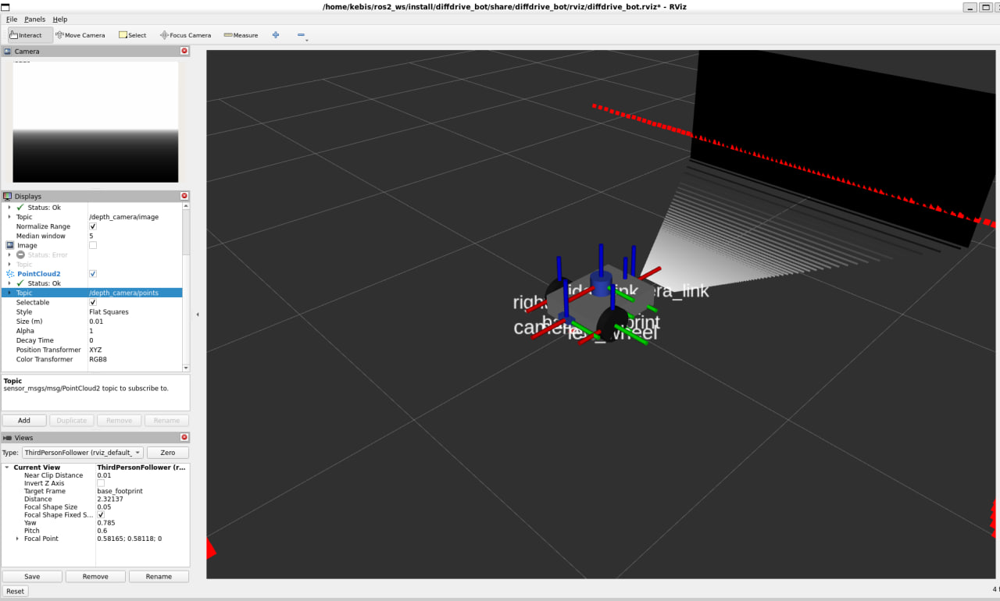
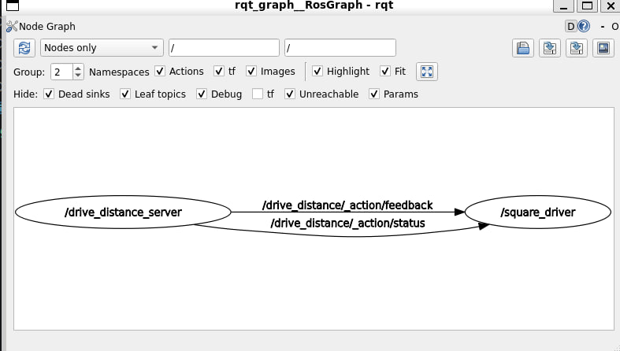

# Lab 1 Exercise: Program diffdrive_bot

This repository is the Lab 1 exercise for **Introduction to Robotics and Intelligent Systems**. It extends the provided `diffdrive_bot` robot with a depth camera and an IMU, then adds student packages that use parameters, a custom message, services, an action server, and an action client that drives a square.

## Project overview

The robot starts from the lab `diffdrive_bot` model (differential drive, lidar, front camera). This exercise adds:

1. A rear depth camera and a chassis IMU in the URDF, Gazebo world, and ROS–Gazebo bridge.
2. `my_robot_interfaces` for `RobotStatus`, `SetTurnSpeed`, and `Rotate`.
3. `my_robot_nodes` for `turn_away`, `rotate_server`, `square_driver`, and `square.launch.py`.

`turn_away` drives forward and turns away from nearby obstacles. `rotate_server` turns in place by a requested yaw. `square_driver` chains `/drive_distance` and `/rotate` to complete a square.

## Environment

- Ubuntu 22.04
- ROS 2 Humble
- Gazebo Harmonic (`ros-humble-ros-gzharmonic`)

Development was done in WSL2 (Ubuntu 22.04 on Windows). See [Known issues](#known-issues) for GUI notes.

Install ROS 2 Humble desktop, then Gazebo Harmonic and the packages listed in `diffdrive_bot/README.md`:

```bash
sudo apt install ros-humble-ros-gzharmonic ros-humble-xacro \
  ros-humble-joint-state-publisher-gui ros-humble-teleop-twist-keyboard
```

## Repository layout

```
lab1_exercise/
├── diffdrive_bot          # robot URDF, world, bridge, launch, lab nodes
├── lab_interfaces         # ObstacleInfo, SetSpeed, DriveDistance
├── my_robot_interfaces    # RobotStatus, SetTurnSpeed, Rotate
└── my_robot_nodes         # turn_away, rotate_server, square_driver, launch
└── Screenshots/
    ├── rviz_depth_camera.jpg
    └── rqt_graph_square.jpg
```

## Build instructions

Place this folder in the `src` directory of a ROS 2 workspace (for example `~/ros2_ws/src/lab1_exercise`).

```bash
source /opt/ros/humble/setup.bash
cd ~/ros2_ws
colcon build --symlink-install --packages-up-to my_robot_nodes
source install/setup.bash
```

`--packages-up-to my_robot_nodes` builds `lab_interfaces`, `my_robot_interfaces`, `diffdrive_bot`, and `my_robot_nodes`.

Source both setup files in every new terminal:

```bash
source /opt/ros/humble/setup.bash
source ~/ros2_ws/install/setup.bash
```

Do not enable `/drive_enable` while student nodes are driving. They all publish `/cmd_vel`; only one driver should be active.

## Run instructions

Rebuild and source after changing interfaces or Python entry points.

### Step 1: Sensors (depth camera + IMU)

Model and frames in RViz:

```bash
ros2 launch diffdrive_bot display.launch.py
```

The depth camera is on the back of the chassis. Frames `depth_camera_link` and `imu_link` should appear.

```bash
ros2 run tf2_ros tf2_echo base_link depth_camera_link
```

Simulation and sensor topics:

```bash
ros2 launch diffdrive_bot gazebo.launch.py
```

In RViz, add an Image display on `/depth_camera/image` and a PointCloud2 display on `/depth_camera/points`. The robot starts with a wall behind it, so the depth camera should see that wall.

```bash
ros2 topic hz /imu
ros2 topic echo /imu
```

`/imu` should run near 50 Hz. While the robot is still, `linear_acceleration.z` is about 9.8.

### Step 2: turn_away

Terminal 1:

```bash
ros2 launch diffdrive_bot control.launch.py
```

Terminal 2:

```bash
ros2 run my_robot_nodes turn_away
```

Then enable the node (required from Step 5 onward; if you are checking an earlier snapshot without the enable service, skip this call):

```bash
ros2 service call /turn_away_enable std_srvs/srv/SetBool "{data: true}"
```

The robot drives toward the red box, turns before hitting it, and continues. `rqt_graph` should show `turn_away` between `/obstacle` and `/cmd_vel`.

### Step 3: Parameters

With `turn_away` running and enabled:

```bash
ros2 param list /turn_away
ros2 param set /turn_away forward_speed 0.4
ros2 param set /turn_away turn_speed 0.8
```

Parameters are read on each obstacle message, so speed changes take effect immediately.

Defaults:

- `forward_speed`: 0.2 m/s
- `turn_speed`: 0.5 rad/s
- `max_turn_speed`: 1.5 rad/s (used by `/set_turn_speed`)

### Step 4: RobotStatus

```bash
ros2 interface show my_robot_interfaces/msg/RobotStatus
ros2 topic echo /robot_status
```

`turn_away` publishes `state` (`forward`, `turning`, or `stopped`) and `obstacle_distance` on `/robot_status` for every `/obstacle` message.

### Step 5: Services

With `control.launch.py` and `turn_away` running:

```bash
ros2 service call /turn_away_enable std_srvs/srv/SetBool "{data: true}"
ros2 service call /set_turn_speed my_robot_interfaces/srv/SetTurnSpeed "{turn_speed: 1.0}"
ros2 service call /set_turn_speed my_robot_interfaces/srv/SetTurnSpeed "{turn_speed: 3.0}"
ros2 service call /turn_away_enable std_srvs/srv/SetBool "{data: false}"
```

The 1.0 rad/s call is accepted. The 3.0 rad/s call is rejected (`max_turn_speed` default is 1.5). After the last call the robot stops and `/robot_status` reports `stopped`.

### Step 6: Rotate action

Stop `turn_away` first so it does not fight `/cmd_vel`.

Terminal 1:

```bash
ros2 launch diffdrive_bot control.launch.py
```

Terminal 2:

```bash
ros2 run my_robot_nodes rotate_server
```

Terminal 3:

```bash
ros2 action send_goal --feedback /rotate my_robot_interfaces/action/Rotate "{angle: 1.57}"
```

The robot turns about a quarter turn left. Feedback climbs toward 1.57 rad.

```bash
ros2 run tf2_ros tf2_echo odom base_link
```

### Step 7: Square driver

One command starts Gazebo, `control.launch.py`, `rotate_server`, and `square_driver`:

```bash
ros2 launch my_robot_nodes square.launch.py side_length:=0.8
```

`square_driver` sends four sequential pairs of goals:

1. `/drive_distance` (`lab_interfaces/action/DriveDistance`) with `distance = side_length`
2. `/rotate` (`my_robot_interfaces/action/Rotate`) with `angle = 1.57`

The next goal is sent only after the previous result. If a goal fails, the sequence stops and the log names the side (1–4). The robot should return close to the start pose. From the default spawn there is room for a square of up to about 1 m per side.

Default `side_length` if omitted: 0.5 m.

## Package descriptions

| Package | Build type | Role |
|---------|------------|------|
| `diffdrive_bot` | ament_python | URDF/xacro, Gazebo world, ros_gz bridge, RViz, lab nodes (`obstacle_detector`, `drive_controller`, `drive_distance_server`), launch files |
| `lab_interfaces` | ament_cmake | `ObstacleInfo.msg`, `SetSpeed.srv`, `DriveDistance.action` |
| `my_robot_interfaces` | ament_cmake | `RobotStatus.msg`, `SetTurnSpeed.srv`, `Rotate.action` |
| `my_robot_nodes` | ament_python | `turn_away`, `rotate_server`, `square_driver`, `square.launch.py` |

### Student interfaces

**RobotStatus.msg**

```
string state
float32 obstacle_distance
```

**SetTurnSpeed.srv**

```
float32 turn_speed
---
bool success
string message
```

**Rotate.action**

```
float32 angle
---
float32 turned
---
float32 turned
```

## Submission checklist

- [x] Depth camera added (`depth_camera_link`, `/depth_camera`)
- [x] IMU added (`imu_link`, `/imu`)
- [x] `RobotStatus.msg`
- [x] `SetTurnSpeed.srv`
- [x] `Rotate.action`
- [x] `turn_away`
- [x] `rotate_server`
- [x] `square_driver`
- [x] `square.launch.py`
- [x] `README.md`
- [x] GitHub URL: https://github.com/kebi-gizachew/Robotics

Also required by the assignment (add to the GitHub repo, not generated here):

### Screenshot of RViz showing the depth image and point cloud (Step 1)


### Screenshot of rqt_graph while square.launch.py is running


## Known issues

### WSL / GUI

This workspace was built and run under WSL2.

- **Gazebo GUI instability.** `gz sim -g` can fail to attach to the server, freeze, or close unexpectedly when the Windows GPU/WSL display path is used. The Gazebo server (`gz sim -s`) and ROS nodes still run. If the GUI is unusable, inspect topics with `ros2 topic echo` / `ros2 topic hz` and use RViz when it starts.
- **RViz OpenGL issues.** RViz may start with a black viewport, missing meshes, or `libGL` / `GALLIUM_DRIVER` warnings under WSLg. Displays can still subscribe; if the 3D view is blank, confirm data with `ros2 topic echo /depth_camera/image` and `/depth_camera/points`.
- **Logic and builds completed successfully.** Packages build with `colcon`. Node, interface, service, and action logic were implemented and verified at the ROS 2 command-line level even when the Gazebo/RViz windows were unstable.

### Runtime notes

- `turn_away` starts **disabled**. Call `/turn_away_enable` with `data: true` before it will drive.
- `rotate_server` rejects a zero-angle goal and rejects goals until the first `/odom` message has arrived.
- `square_driver` waits for both action servers before sending the first goal. If an obstacle aborts `/drive_distance`, the square stops on that side.
- Do not run `turn_away` and `square.launch.py` at the same time: both command `/cmd_vel`.
